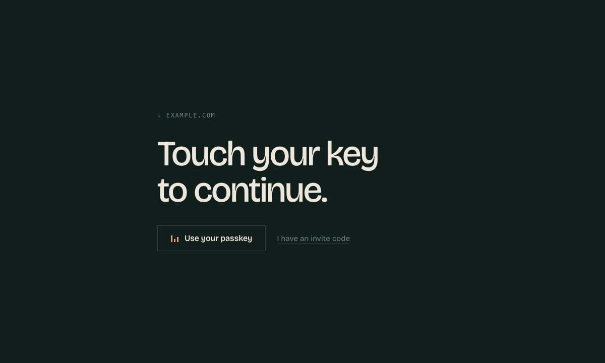

# doorman

One passkey login for the sites on your domain. Give a guest a short code to
open just the subdomains you choose.

[Try the local demo](#quickstart) · [Set up Caddy and your first passkey](docs/runbook.md)

<p align="center">
  
</p>

You have a handful of small sites on one domain — a recipe box, a photo dump,
something half-built you would rather not show anyone yet. You want to reach all
of them from any of your devices without typing anything, and you want to let one
other person into one of them for a week without making them an account.

doorman sits in front of those sites. Caddy asks the same small Python service
about each request. SQLite holds the access records, and the config needs no
shared password or signing secret.

<a id="what-it-actually-does"></a>

## What it can do

- **Sign in as the owner.** Use Face ID, Touch ID, or another passkey with user
  verification. One session opens every protected site on your domain.
- **Invite a guest for a visit.** Pick their sites and a time limit. Read out
  three words and two digits or send a link. A guest code works on up to three
  browsers and their guest sessions expire with the invite.
- **Give a regular visitor a passkey.** A member redeems their invite once,
  enrolls a passkey on that visit, and can return to the sites you granted.
  Both guests and members can also reach the sign-in host.
- **Manage access.** See who has a key and which sessions are live. Change
  someone's sites, extend their time, or revoke access from the admin page.
  The CLI handles owner enrollment, inspection, and revocation.
- **Protect static and proxied sites.** The same Caddy `forward_auth` check works
  for a folder of HTML and an app listening on a port. Each site's own code
  stays as it is.

<p align="center">
  
</p>

<a id="try-it-without-deploying-anything"></a>

## Quickstart

The local demo needs Git and Python 3. All its sample data lives in memory.

```bash
git clone https://github.com/jclark2496/doorman.git
cd doorman
python3 examples/demo-server.py
```

Open the [demo sign-in page](http://127.0.0.1:8600/login.html). Choose **I
have an invite code** if prompted, paste `coral-lounger-palm-42`, and press
**Enter**. The page briefly shows “You're in.” before redirecting. The
[admin demo](http://127.0.0.1:8600/admin.html) lists Jill, Bob, and Sam. Try
the **Sites** or **Time** button on Bob's row. Restarting resets the demo.

The demo simulates an owner and accepts a fixed sample code. For real passkey
enrollment and access checks, use the [deployment runbook](docs/runbook.md).

## The one constraint

The session cookie is scoped to a domain, and a passkey is bound to a
relying-party ID that must be a registrable domain. Both mean **every site
doorman protects has to be that domain or a subdomain of it.**

`notes.example.com` and `photos.example.com` can share one login.
`example.net` cannot — not with more configuration, not with a redirect. That is
the browser's rule for both cookies and passkeys, and a project that told you
otherwise would be lying. Sites on another domain need their own doorman.

## Managing it

The reference admin page shows who can get in, what each person can reach, and
how long they have. You can issue the next invite from the same page.

<p align="center">
  
</p>

Three decisions in there are worth naming, because they are the ones that took a
second attempt.

**Giving someone longer sends nothing.** When you give Bob another week,
doorman extends his live invites and sessions. He can use the code he already
has. A browser that calls `/_auth/me` before its cookie expires picks up the new
deadline. Any deadline already further out stays as it is.

**Revoking asks, and asks the right question.** For someone with a passkey the
choice that matters is not yes/no — it is whether their key survives. Keep it and
you can let them back in with a click; remove it and they need a fresh invite.

<p align="center">
  
</p>

**A code is shown once, so it gets the whole page.** Nothing competes with it
while you are reading it out loud.

<p align="center">
  
</p>

The CLI covers what you might need without a browser:

```
doorman.py list                    # users, roles, keys, live sessions
doorman.py enroll-owner            # your first passkey, and the recovery path
doorman.py revoke <name> [--keys]
doorman.py revoke-all-sessions
```

## Running it for real

```bash
python3 -m venv .venv && .venv/bin/pip install -r requirements.txt
.venv/bin/python -m unittest discover -s tests -t .
```

87 tests, about eighteen seconds, no network. Then follow
[docs/runbook.md](docs/runbook.md) — a system user, an env file, a systemd unit,
a Caddyfile, and enrolling your own key. Examples for all of those are in
[examples/](examples/).

To customize a fork, set the sign-in domain, protected hosts, site aliases, and
owner name in the [example environment file](examples/doorman.env.example).
The [reference pages](web/) cover login, denied access, and administration.
Copy them into your web root and restyle them, or write your own against the
same endpoints. The service checks access on the server.

## One design decision

The access rule fits in one function. Given the user, session, requested host,
current time, and sign-in host, it can answer Caddy without opening SQLite or
reading the clock. That makes a detail easy to check before you put private
content on a site. Every signed-in person can reach the sign-in host, and a
guest needs an explicit grant for any other protected host. The same tests
check that even the owner loses access when their session expires. [Access
rule](doorman/gate.py) · [Tests for each role](tests/test_gate.py)

## How it is put together

```
doorman/config.py     everything from the environment; no secrets
doorman/store.py      SQLite. Conditional UPDATEs where a race would matter
doorman/gate.py       the decision: may this person have this host, right now
doorman/passkeys.py   the WebAuthn ceremonies
doorman/service.py    sessions, invites, and the owner operations
doorman/http.py       the routes
doorman/words.py      the invite vocabulary
```

## What it is not

- **Not an identity provider.** No OAuth, no OIDC, no SAML, no tokens for other
  services to verify. It answers one question for one Caddy instance.
- **Not multi-tenant, and not multi-domain.** See the constraint above.
- **Not audited.** It is a careful implementation of a well-specified standard,
  used in front of my own sites. Read it before you trust it with yours — it is
  short enough that you can.

## Notes on the design

A few things here are the second version, and the first version is why.

A relying-party name with a space in it shipped unquoted in the example env file. systemd
accepted it; `sh` read it as an assignment followed by a command and broke a
deployment. There is now a test that sources the shipped file with `sh` on every
run — not a copy of it, the file itself, because a copy keeps passing after the
original drifts.

The service is `Type=simple`, so systemd calls it active before its socket is
bound, and a health check straight after a restart raced it. The runbook now
carries one bounded retry, written identically everywhere it appears, and a test
runs the text **as shipped** against a listener that deliberately binds late.
Another test asserts that every mention of the health endpoint anywhere in the
runbook falls inside one of those retry blocks — prose included, because prose
gets pasted.

A single-use enrollment code once produced two passkeys when redeemed twice in
quick succession. The fix that stuck was moving the atomic claim ahead of the
credential write: gating the session was not enough, because the credential was
already written by then.

[Read the doorman build note on Forkthis](https://forkthis.ai/doorman/).

## Licence

MIT. See [LICENSE](LICENSE).
