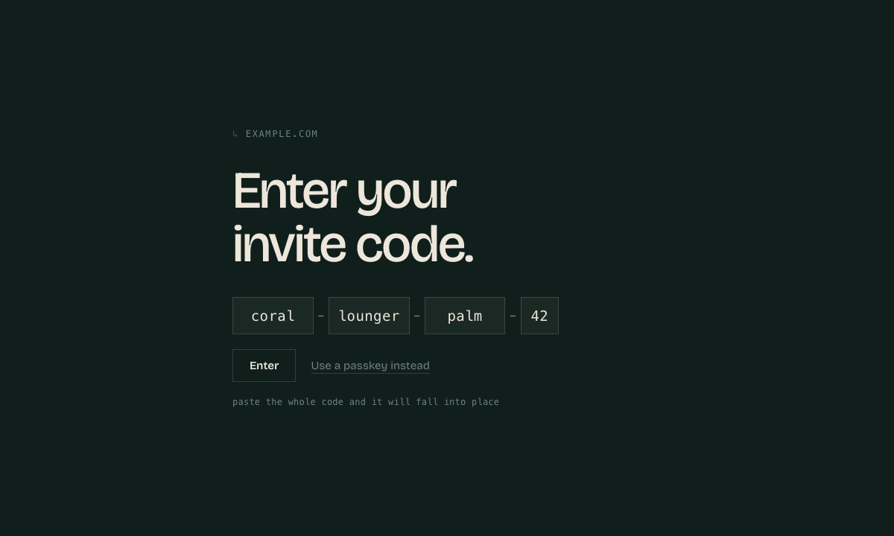
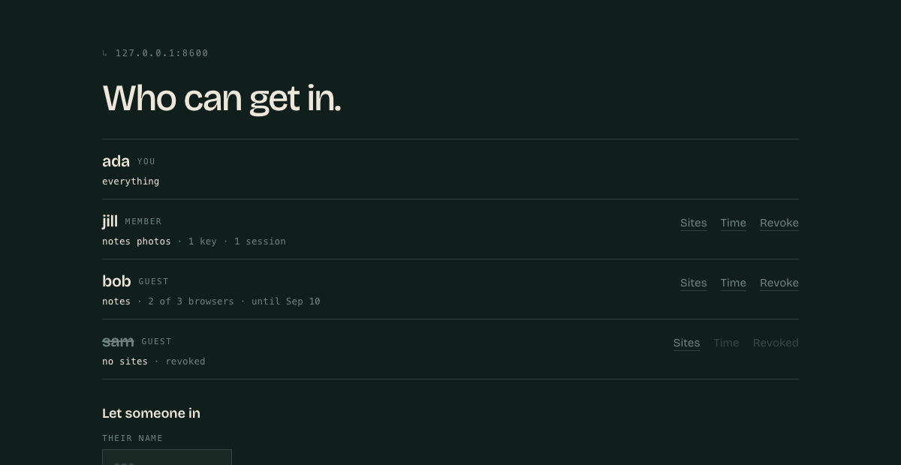
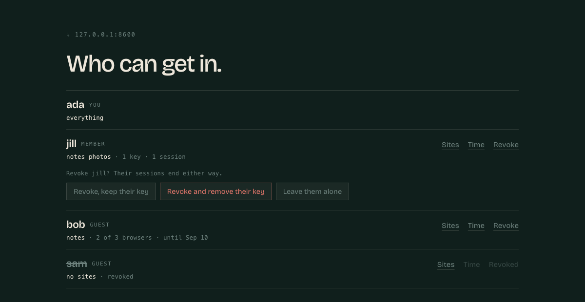
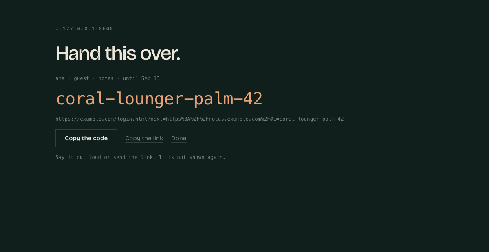

# doorman

One login for every site you own.

You have a handful of small sites on one domain — a recipe box, a photo dump,
something half-built you would rather not show anyone yet. You want to reach all
of them from any of your devices without typing anything, and you want to let one
other person into one of them for a week without making them an account.

doorman is the thing in front of all of them. You sign in once with Face ID or
Touch ID and every site is open. Anyone else gets three words and two digits,
good for exactly the sites and exactly the days you said.

<p align="center">
  
</p>

It is about a thousand lines of Python, one dependency, and a SQLite file. There
is no shared password anywhere in it, and no secret in its config.

---

## What it actually does

**You sign in with a passkey.** A real WebAuthn ceremony — discoverable
credentials, user verification required — so it is Face ID on your phone, Touch
ID on your laptop, and a synced key on anything else. There is no password to
phish, reuse, or leave in a config file.

**Everyone else gets a code.** Three words and two digits, said out loud or sent
as a link: `coral-lounger-palm-42`. It is good for the sites you named, for the
days you named, on up to three browsers. When it runs out, it runs out.

**Someone you trust gets a passkey too.** A "member" invite is redeemed once and
enrolls their own passkey on the spot, in that same visit. After that they sign
in the way you do, into only the sites you gave them.

**Every site is behind the same door.** Caddy asks doorman about each request
before serving anything, so a site is protected whether it is a folder of HTML or
an app on a port — with no library, no SDK, and no change to the site itself.

<p align="center">
  
</p>

## The one constraint

The session cookie is scoped to a domain, and a passkey is bound to a
relying-party ID that must be a registrable domain. Both mean **every site
doorman protects has to be that domain or a subdomain of it.**

`notes.example.com` and `photos.example.com` can share one login.
`example.net` cannot — not with more configuration, not with a redirect. That is
the browser's rule for both cookies and passkeys, and a project that told you
otherwise would be lying. Sites on another domain need their own doorman.

## Managing it

There is a reference admin page: who can get in, what each person can reach, how
long they have, and letting someone new in. Same operations as the CLI, without
typing them.

<p align="center">
  
</p>

Three decisions in there are worth naming, because they are the ones that took a
second attempt.

**Giving someone longer sends nothing.** Extending moves a person's invite and
every browser they are already signed in on to the same date at once, so the
laptop they are reading on simply carries on. Re-inviting would have worked too,
but it mints a code they have to go and redeem — the answer to "give Bob another
week" should not be "message Bob". It only ever moves a deadline forward, so
asking for less than someone already has leaves them alone and says so.

**Revoking asks, and asks the right question.** For someone with a passkey the
choice that matters is not yes/no — it is whether their key survives. Keep it and
you can let them back in with a click; remove it and they need a fresh invite.

<p align="center">
  
</p>

**A code is shown once, so it gets the whole page.** Nothing competes with it
while you are reading it out loud.

<p align="center">
  
</p>

The CLI covers what you might need without a browser:

```
doorman.py list                    # users, roles, keys, live sessions
doorman.py enroll-owner            # your first passkey, and the recovery path
doorman.py revoke <name> [--keys]
doorman.py revoke-all-sessions
```

## Try it without deploying anything

```bash
git clone https://github.com/jclark2496/doorman.git && cd doorman
python3 examples/demo-server.py
```

Then open <http://127.0.0.1:8600/admin.html>, or `/login.html` and type
`coral-lounger-palm-42`. It fakes the service in memory — no database, no real
check — so the pages can be looked at. The passkey path needs a real deployment,
since a browser will not do WebAuthn against `127.0.0.1` with someone else's
relying-party ID.

## Running it for real

```bash
python3 -m venv .venv && .venv/bin/pip install -r requirements.txt
.venv/bin/python -m unittest discover -s tests -t .
```

87 tests, about eighteen seconds, no network. Then follow
[docs/runbook.md](docs/runbook.md) — a system user, an env file, a systemd unit,
a Caddyfile, and enrolling your own key. Examples for all of those are in
[examples/](examples/).

`web/` is the reference front end: login, denied, admin. Copy it into your site's
web root and restyle it, or write your own against the same endpoints — the pages
hold no authority, because every route re-checks server-side.

## How it is put together

```
doorman/config.py     everything from the environment; no secrets
doorman/store.py      SQLite. Conditional UPDATEs where a race would matter
doorman/gate.py       the decision: may this person have this host, right now
doorman/passkeys.py   the WebAuthn ceremonies
doorman/service.py    sessions, invites, and the owner operations
doorman/http.py       the routes
doorman/words.py      the invite vocabulary
```

`gate.py` is deliberately a pure function of (user, session, host, now). It has
no database and no clock of its own, so the rule that decides everything can be
read in one sitting and tested exhaustively.

## What it is not

- **Not an identity provider.** No OAuth, no OIDC, no SAML, no tokens for other
  services to verify. It answers one question for one Caddy instance.
- **Not multi-tenant, and not multi-domain.** See the constraint above.
- **Not audited.** It is a careful implementation of a well-specified standard,
  used in front of my own sites. Read it before you trust it with yours — it is
  short enough that you can.

## Notes on the design

A few things here are the second version, and the first version is why.

A relying-party name with a space in it shipped unquoted in the example env file. systemd
accepted it; `sh` read it as an assignment followed by a command and broke a
deployment. There is now a test that sources the shipped file with `sh` on every
run — not a copy of it, the file itself, because a copy keeps passing after the
original drifts.

The service is `Type=simple`, so systemd calls it active before its socket is
bound, and a health check straight after a restart raced it. The runbook now
carries one bounded retry, written identically everywhere it appears, and a test
runs the text **as shipped** against a listener that deliberately binds late.
Another test asserts that every mention of the health endpoint anywhere in the
runbook falls inside one of those retry blocks — prose included, because prose
gets pasted.

A single-use enrollment code once produced two passkeys when redeemed twice in
quick succession. The fix that stuck was moving the atomic claim ahead of the
credential write: gating the session was not enough, because the credential was
already written by then.

## Licence

MIT. See [LICENSE](LICENSE).
